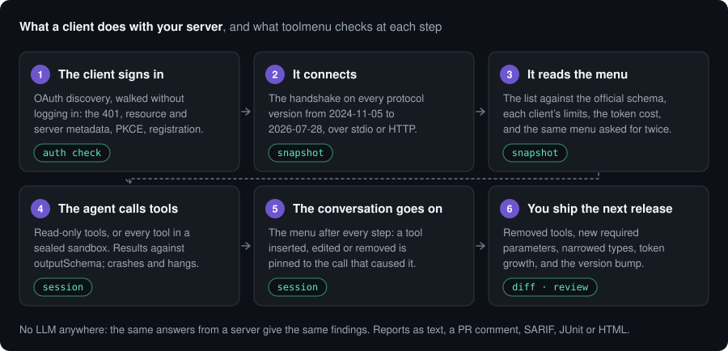
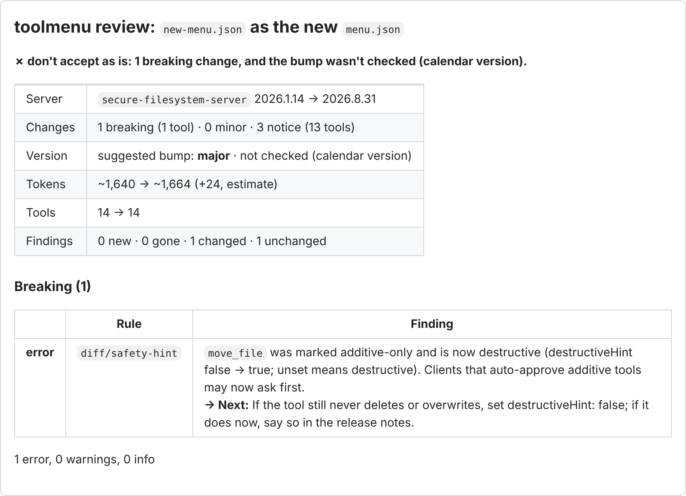
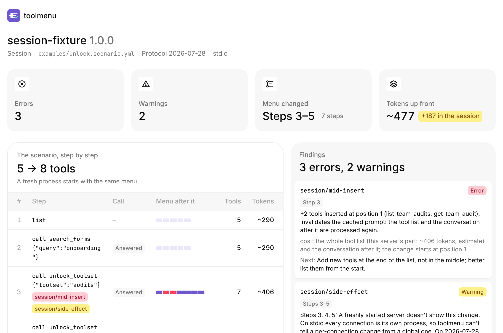

<p align="center">
  
</p>

<h1 align="center">toolmenu</h1>

<p align="center">
  <b>Tests your MCP server the way agents and clients meet it: the menu they read, the calls they make, the results and sign-in they get back, and every release after.</b>
</p>

<p align="center">

[](https://www.npmjs.com/package/toolmenu)
 [](https://github.com/niksa90/toolmenu/actions/workflows/ci.yml)
 [](https://github.com/niksa90/toolmenu/blob/main/LICENSE)
 [](https://modelcontextprotocol.io)
 [](https://github.com/niksa90/toolmenu)
[](https://glama.ai/mcp/servers/niksa90/toolmenu)
[](https://mcprush.com/to/toolmenu-mcp?ref=badge)
[](https://mcpservers.org/servers/niksa90/toolmenu)

## License

MIT


</p>

An MCP server can pass its own tests and still fail in the client. The client's SDK
rejects a tool list the server's own test client accepted. A default built from the
clock makes every listing different, so no prompt cache ever matches. A patch release
makes a parameter required. None of it shows until someone's agent has fewer tools, or
a bigger bill, and no error to explain it.

toolmenu does what a client does, in order, and checks each step against the spec, the
tool's own schemas and each client's documented limits:



No LLM is involved, so the same server gives the same findings on every run and it fits
in CI. It doesn't tell you whether an agent picks the right tool; that takes evals with a
model ([what it can't catch](#what-it-cant-catch)).

```sh
npx toolmenu snapshot -- node dist/server.js      # or: npx toolmenu snapshot https://example.com/mcp
npx toolmenu init -- node dist/server.js          # CI: a baseline, a workflow, a comment on every PR
```

Needs Node 22 or later. Your server can be in any language: toolmenu starts it (stdio)
or connects to it (HTTP).


**Contents:** [What it catches](#what-it-catches) · [A finding](#what-a-finding-looks-like) ·
[In CI](#in-ci-one-pr-comment) · [Commands](#commands) · [Tested on real servers](#tested-on-real-servers) ·
[What it can't catch](#what-it-cant-catch) · [Docs](#docs)

## What it catches

Each row is something a run on real servers found
([docs/FINDINGS.md](https://github.com/niksa90/toolmenu/blob/main/docs/FINDINGS.md) has the versions and how to reproduce each).

| | What goes wrong | Seen on |
|---|---|---|
| **Lists and results a client rejects** | The official SDK client validates `tools/list` and every result. One bad schema and it drops the whole list; an answer that breaks the tool's own `outputSchema` becomes an error | 12 of 1,089 registry servers: 8 lose every tool, 4 lose answers |
| **A menu that never matches twice** | A default built from the clock, an order from a hash set, a container ID in a description. Every listing or every restart is a new menu, so cached prompts miss | PayPal (`list_transactions` dates), mcp-atlassian, Desktop Commander |
| **A menu that changes mid-conversation** | Most clients put tools first in the prompt, so a tool added by an "unlock" call means the conversation after it is processed again. 2026-07-28 rules per-connection menus out | One unlock re-processed 40–57K cached tokens in the author's own logs |
| **Releases that break callers** | Removed tools, new required parameters, narrowed types, a tool that became destructive, with the version bump the change needs | The official filesystem server made `move_file` destructive in a calendar release; Exa removed tools in patch releases |
| **Sign-in a strict client can't finish** | OAuth discovery that differs from the RFCs: a `resource` that isn't the server's URL, metadata that isn't there, PKCE not advertised | 12 of 79 vendor endpoints that answer 401 name a parent or slash-variant `resource` |
| **Tools one client can't use** | More tools than the client sends, names its API refuses or rewrites, descriptions cut before the instruction that matters | 6 servers in Docker's catalog list more than VS Code's 128 a request |
| **Tokens spent on nothing** | Unused `$defs`, the same schema block repeated across tools, growth per release | Notion's server: the same 9 unused `$defs` in all 24 tools, 72% of its menu |

It also has heuristics for what agents misread (a parameter called just `id`, writes
with no annotations, two tools fighting over one word). Those are marked as guesses and
are never errors. Every rule is in [docs/RULES.md](https://github.com/niksa90/toolmenu/blob/main/docs/RULES.md).

## What a finding looks like

A server whose `unlock_toolset` tool adds two tools to the menu mid-conversation, run
with `toolmenu session`:

```
step 3: call unlock_toolset {"toolset":"audits"} · answered · menu changed · +2 tools · list_changed received
  ERROR  session/mid-insert
         +2 tools inserted at position 1 (list_team_audits, get_team_audit). Invalidates the cached prompt:
         the tool list and the conversation after it are processed again.
           cost: the whole tool list (this server's part: ~406 tokens, estimate) and the conversation after it
         → Next: Add new tools at the end of the list, not in the middle; better, list them from the start.
  WARN   session/unlock-coverage · unsure
         unlock_toolset looks like it unlocks tools, and the run got through 1 of its 2 toolset values. […]
           not unlocked: "reports"
         → Next: Unlock every value: session --init puts each one in the starter.
```

Every finding has the same parts: a **level** (`ERROR`, `WARN`, `INFO`; `--fail-on`
decides which fail the run), a **rule id** you can look up (`toolmenu explain
session/mid-insert`) or turn off in the config, **where** it happened (the step, the
tool, the parameter path), **what toolmenu saw**, and a **`→ Next:`** step.

How much to trust a finding depends on what it rests on, and the rule id's prefix says which:

| Rule family | What it rests on |
|---|---|
| `spec/`, `apps/`, `lists/schema` | The protocol: the official JSON schema for the server's version (pinned in `schemas/`), a MUST/SHOULD in the spec, or the MCP Apps extension |
| `diff/` | Two menus compared. A **breaking** change is one where a call that passed validation before now fails it |
| `session/`, `menu/`, `lists/variance`, `auth/`, `catalog/` | Behaviour toolmenu observed: the menu changing after a step, between two calls, between two processes or connections, or served to a bad credential. The finding names the step or the call |
| `naming/`, `ids/`, `description/`, `write/`, `search/` | How agents read the menu: names, words, descriptions. Tuned on real servers, but heuristics |

A finding marked **`· unsure`**, in any family, rests on names and words rather than on
something toolmenu saw happen (above: "looks like it unlocks tools"). It says what was
seen, not what it means. No LLM is involved anywhere: the same server gives the same
findings on every run.

## In CI: one PR comment

`npx toolmenu init -- <your server command>` snapshots the server into `menu.json` (the
baseline) and writes this workflow for your project (Node, Python, Go or Rust). Commit
both. Credentials you pass go into the workflow as `${{ secrets.… }}`, never as text.

```yaml
# .github/workflows/toolmenu.yml
on: pull_request
permissions:
  contents: read
  pull-requests: write
jobs:
  toolmenu:
    runs-on: ubuntu-latest
    steps:
      - uses: actions/checkout@v7
      - uses: actions/setup-node@v7
        with: { node-version: 22 }
      - run: npm ci && npm run build
      - uses: niksa90/toolmenu@v0.27.0
        with:
          command: node dist/server.js
          baseline: menu.json          # your committed snapshot
          scenario: scenario.yml       # optional: run a session too
```

Every pull request then gets one comment that updates on each push. It leads with a
verdict (can this menu replace the baseline as it is?), then the breaking changes, the
token change, the version bump the change needs, and anything `session` caught:

<p align="center">
  
</p>

That's `toolmenu review --format markdown` on two real releases of the official
filesystem server. The same findings go to GitHub code scanning (SARIF), to GitLab,
Jenkins and others as JUnit, or into one offline HTML page:

<p align="center">
  
</p>

Inputs, servers behind auth, forks and `gate: review` are in
[docs/github-action.md](https://github.com/niksa90/toolmenu/blob/main/docs/github-action.md); SARIF, JUnit, HTML and the badge in
[docs/ci.md](https://github.com/niksa90/toolmenu/blob/main/docs/ci.md).

## Commands

| Command | What it does | |
|---|---|---|
| `snapshot` | Connects, lists the menu, checks it (the spec, a second process, your client's limits, token cost) and writes `menu.json` | [docs](https://github.com/niksa90/toolmenu/blob/main/docs/snapshot.md) |
| `session` | Plays a scenario, or builds one with `--auto`: calls tools, checks every result, and lists the menu after each step. Read-only tools unless you allow writes; `--call-everything` calls every tool, for a server in a sandbox | [docs](https://github.com/niksa90/toolmenu/blob/main/docs/session.md) |
| `diff` | Compares two menu files: breaking, minor, notice; token change; the semver bump | [docs](https://github.com/niksa90/toolmenu/blob/main/docs/diff.md) |
| `review` | Should the new menu replace the baseline? One verdict and an exit code | [docs](https://github.com/niksa90/toolmenu/blob/main/docs/diff.md#accepting-a-new-baseline-review) |
| `auth check` | Walks an HTTP server's OAuth discovery as a spec-following client does, without logging in | [docs](https://github.com/niksa90/toolmenu/blob/main/docs/usage.md#http-servers-and-oauth) |
| `auth login` | Signs in to a server behind OAuth once, in a browser; `snapshot` and `session` then use that login | [docs](https://github.com/niksa90/toolmenu/blob/main/docs/usage.md#http-servers-and-oauth) |
| `scan` | `snapshot` on every server in a client config (Claude Desktop, `.mcp.json`, Cursor, VS Code), side by side | [docs](https://github.com/niksa90/toolmenu/blob/main/docs/snapshot.md#every-server-you-use-scan) |
| `history` | Installs a package's published versions one by one and diffs them. Runs third-party code: use a container | [docs](https://github.com/niksa90/toolmenu/blob/main/docs/diff.md#history-a-packages-releases-researched) |
| `init` | Writes the baseline and the CI workflow | [above](#in-ci-one-pr-comment) |
| `mcp` | toolmenu as an MCP server and a Claude Code plugin, so the agent building your server can check it while it works | [docs](https://github.com/niksa90/toolmenu/blob/main/docs/usage.md#for-the-agent-building-your-server-mcp) |
| `explain <rule>` | What a rule checks, its default level and how to change it | [RULES](https://github.com/niksa90/toolmenu/blob/main/docs/RULES.md) |

`--client <name>` checks the menu for one client, from that client's own docs: Claude
Code, the Claude API, OpenAI, Codex, VS Code (Copilot Chat), Copilot cloud agent and code
review, Gemini CLI, the Gemini API or Antigravity ([docs](https://github.com/niksa90/toolmenu/blob/main/docs/clients.md)). A client
that doesn't document a limit doesn't get one: Cursor's and Windsurf's aren't checked.

`session` calls tools for real. Without `allow_writes: true` it refuses any tool not
marked `readOnlyHint: true`, and `--call-everything` is refused over HTTP, because a
hosted server's tools act on someone's real account.

Everything is also exported as a library, with types
([docs](https://github.com/niksa90/toolmenu/blob/main/docs/usage.md#as-a-library)). All protocol versions from 2024-11-05 to
2026-07-28 are supported, through the official TypeScript SDK; the table in
[docs/PROTOCOLS.md](https://github.com/niksa90/toolmenu/blob/main/docs/PROTOCOLS.md) is written by a test that runs each one.

## Tested on real servers

Rules are checked against public MCP servers before they ship, and a rule that changes
a finding on one has to say why in the [changelog](CHANGELOG.md). The run on 2026-11-09
is the baseline for a weekly one ([`bench/scripts/weekly.sh`](bench/scripts/weekly.sh)),
which compares each week with the last:

| Panel | Servers | What ran |
|---|---|---|
| Registry stdio servers (npm), pinned versions | 1,089 | `snapshot`, `session --auto`, and every tool called in a container with no network and no credentials: 15,550 of 16,518 tools |
| Docker's MCP catalog, at the digests it pins | 237 | The same: 4,117 of 4,237 tools called (41 servers didn't list tools) |
| Servers vendors publish to run locally (GitHub, AWS Labs, Microsoft, PayPal, Stripe, Notion, HashiCorp, Grafana…) | 98 | The same, with dummy credentials: 2,213 of 2,292 tools called (20 didn't list tools) |
| Hosted servers: 109 vendor endpoints and a seeded 2,000 from the registry | 2,109 | `snapshot`, a read-only `session --auto` of at most 10 calls, `auth check` on each that answers 401 |

Read those numbers for what they are. Most servers pass most checks: about 1 in 90 of
the registry's stdio servers fails in the official SDK client. A sealed container with
made-up input shows whether a tool crashes, hangs or breaks its own schema, not whether
it does its job: more than half of the calls there came back as a readable tool error,
the right answer to made-up input or a dummy key. Hosted servers got a few read-only calls each.

The reference server, `@modelcontextprotocol/server-everything`, gets no false finding,
and a clean fixture server must get none from any command; the test suite fails if one
appears. What the runs found, including what toolmenu itself got wrong and how it was
fixed, is in [docs/FINDINGS.md](https://github.com/niksa90/toolmenu/blob/main/docs/FINDINGS.md). The corpora, the scripts and the
datasets are in [bench/](bench/README.md).

## What it can't catch

toolmenu sees what the server sends. Plenty of agent failures happen elsewhere:

- **Whether the agent picks the right tool.** That needs evals with a model. toolmenu
  stays deterministic on purpose; `routes.yml` pins keyword routing, which is as far as
  it goes.
- **What the client does with the menu.** Clients merge several servers, sort, filter
  and cut. A stable server menu is necessary for cache hits, not sufficient. The
  `--client` profiles cover what each client documents, and nothing it doesn't.
- **A feature with no tools.** If the agent reaches for something your menu doesn't
  have, no menu check sees the gap.
- **Whether a tool does its job.** A call that answers is checked against the schema it
  declares, not against what it should have done.
- **Security.** It isn't a security scanner or a full conformance suite.

Token counts are estimates (`o200k_base`) of what the model reads: each tool's name,
description and input schema. Vendors tokenize, cache and bill differently.

## Docs

- [snapshot](https://github.com/niksa90/toolmenu/blob/main/docs/snapshot.md): rules, where the tokens go, `routes.yml`, the config file, `scan`
- [session](https://github.com/niksa90/toolmenu/blob/main/docs/session.md): scenarios, `--init`, `--auto`, `--call-everything`, every session rule
- [diff, review, catalogs, history](https://github.com/niksa90/toolmenu/blob/main/docs/diff.md): how changes are classified, the verdicts, operations behind a search tool
- [clients](https://github.com/niksa90/toolmenu/blob/main/docs/clients.md): what each `--client` profile checks, and its sources
- [usage](https://github.com/niksa90/toolmenu/blob/main/docs/usage.md): HTTP and OAuth, proxies, the MCP server and plugin, the library, every option
- [the GitHub Action](https://github.com/niksa90/toolmenu/blob/main/docs/github-action.md) and [other CI output](https://github.com/niksa90/toolmenu/blob/main/docs/ci.md)
- [RULES](https://github.com/niksa90/toolmenu/blob/main/docs/RULES.md), [PROTOCOLS](https://github.com/niksa90/toolmenu/blob/main/docs/PROTOCOLS.md), [FINDINGS](https://github.com/niksa90/toolmenu/blob/main/docs/FINDINGS.md), [SPEC](https://github.com/niksa90/toolmenu/blob/main/docs/SPEC.md), [CHANGELOG](CHANGELOG.md)

## About

Built by [Nikša Perović](https://niksa.me) while running a 115-tool MCP server and
watching agents trip over its menu. It started as a check for menus that change at the
wrong time ([the story, and where it was wrong](https://niksa.me/toolmenu)) and grew
into a client-side test for the whole server as real servers kept failing in other
places.

Found a false positive, or a failure toolmenu should catch?
[Open an issue](https://github.com/niksa90/toolmenu/issues) with the menu (a
`menu.json` is enough) and what you expected.

